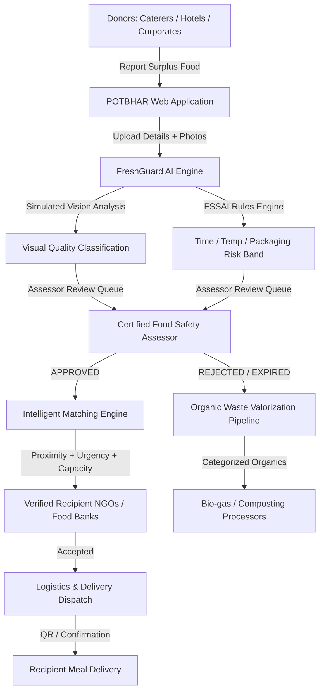

# 🍛 POTBHAR (पोटभर) — Surplus Food Redistribution & Zero Waste Platform
> **"Har Pet Bhare, Har Nivala Sambhale"**  
> *AI-Powered Food Quality Assessment, Hyperlocal Redistribution & Organic Waste Management*

---

## 🌟 Executive Summary

POTBHAR is a comprehensive, production-grade platform built to solve India's food waste and hunger paradox. While **190+ million people go undernourished** daily in India, over **68 million tonnes of food is wasted annually** from banquets, corporate cafeterias, and restaurants. 

POTBHAR tackles both sides of the equation:
1. **Edible Surplus Food Recovery**: Screened by **FreshGuard AI**, verified by certified food safety assessors, and routed to verified hunger-relief recipient organizations using proximity-weighted matching.
2. **Organic Waste Valorization**: Food deemed unsuitable for human consumption is diverted to verified composting and biogas processors with chain-of-custody tracking.
3. **Audited Transparency**: FSSAI-aligned audit trails, chain-of-custody tracking, and real-time impact metrics (meals served, kg recovered, CO₂ diverted).

---

## 🏗 System Architecture & Technology Stack



### Technology Stack
- **Frontend**: React 18, Vite 5, Tailwind CSS, Recharts, Lucide Icons, React Router v6
- **Backend**: FastAPI (Python 3.11), SQLAlchemy ORM, Pydantic v2, Python-Jose (JWT), SQLite (Dev) / PostgreSQL-ready
- **AI / ML Service**: **FreshGuard AI** — Multi-modal risk screening incorporating temperature exposure limits, food category decay rates, packaging integrity, and simulated visual defect classification
- **Security**: Role-Based Access Control (RBAC) across 6 roles, bcrypt-compatible salted SHA-256 password hashing, bearer JWT tokens

---

## 🚀 Running the Project Locally

### 1. Backend Server (FastAPI)
```bash
cd backend
python -m uvicorn app.main:app --host 127.0.0.1 --port 8000
```
- **API Base URL**: `http://127.0.0.1:8000/api/v1`
- **Interactive Swagger Docs**: `http://127.0.0.1:8000/docs`
- **ReDoc**: `http://127.0.0.1:8000/redoc`

### 2. Frontend Development Server (React + Vite)
```bash
# In the project root:
npm install
npm run dev
```
- **Web App**: `http://localhost:3000/`

---

## 🌐 Deploying to Production

### Frontend on Netlify
1. Connect your repository to Netlify.
2. Build Settings:
   - **Base directory**: Leave blank (root)
   - **Build command**: `npm run build`
   - **Publish directory**: `dist`
3. Environment Variables (optional, for connecting to your Render backend):
   - `VITE_API_URL`: Your Render backend URL (e.g., `https://potbhar-backend.onrender.com`)

### Backend on Render
1. Create a **New Web Service** from your repository.
2. Settings:
   - **Root Directory**: `backend`
   - **Runtime**: `Python 3`
   - **Build Command**: `pip install -r requirements.txt`
   - **Start Command**: `uvicorn app.main:app --host 0.0.0.0 --port $PORT`

---

## 🔑 Pre-Seeded Demo Credentials

You can test every role in the platform using one-click quick login buttons on the login page or with the following credentials (all passwords: `demo123`):

| Role | Email | Password | Description & Access |
|---|---|---|---|
| **Donor** | `donor@potbhar.demo` | `demo123` | Green Feast Caterers — Report food batches, assess FreshGuard risk, report organic waste |
| **Recipient (NGO)** | `recipient@potbhar.demo` | `demo123` | Asha NGO Food Bank — Post food requirements, view & accept donation matches |
| **Food Assessor** | `assessor@potbhar.demo` | `demo123` | Food Safety Specialist — Review incoming batches, inspect FreshGuard flags, approve/reject |
| **Waste Processor**| `processor@potbhar.demo` | `demo123` | EcoCompost Delhi — Receive diverted organic waste batches and log compost/biogas yields |
| **System Admin** | `admin@potbhar.demo` | `demo123` | Platform Administrator — Organization verification, system-wide analytics, audit logs |

---

## 🧪 Verified Feature Checklist

- [x] **JWT Authentication & RBAC**: Donor, Recipient, Assessor, Processor, Admin roles.
- [x] **Food Batch Management**: Complete CRUD with preparation time, storage temperature, packaging integrity, and handling history completeness.
- [x] **FreshGuard AI Vision & Risk Assessment**: Rules-based quality risk screening with FSSAI-informed danger zone time limits and visual confidence scoring.
- [x] **Assessor Review Queue**: Human-in-the-loop approval workflow with mandatory decision rationale.
- [x] **Hyperlocal Matching Algorithm**: Haversine distance calculation, capacity constraints, urgency weighting, and top-3 recipient ranking.
- [x] **Recipient Offers & Requirements**: Real-time offer acceptance and dietary constraint filtering.
- [x] **Zero Waste Pipeline**: Organic waste batch creation, processor assignment, receipt confirmation, and biogas/compost output tracking.
- [x] **Platform Analytics & SDG Alignment**: Real-time counters for meals recovered, organic waste diverted, CO₂ offset, and active organizations.
- [x] **Responsive Premium UI**: Glassmorphic dark theme, intuitive layout, interactive badges, Recharts visualizations, and accessibility.

---

## 🌍 UN Sustainable Development Goals (SDG) Alignment

- **SDG 2 — Zero Hunger**: Rapid redistribution of quality-checked surplus food to undernourished communities.
- **SDG 11 — Sustainable Cities & Communities**: Localized routing reducing transit time and urban waste pile-up.
- **SDG 12 — Responsible Consumption & Production**: Prevention of edible food waste and complete diversion of non-edible organics.
- **SDG 13 — Climate Action**: Methane mitigation through composting and biogas generation instead of landfill disposal.
